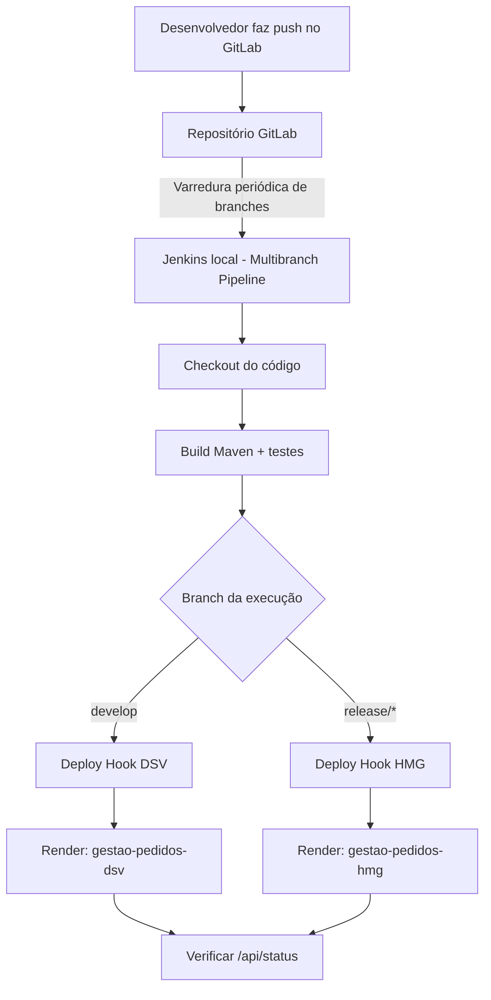
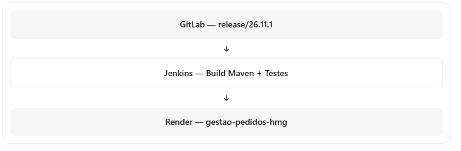
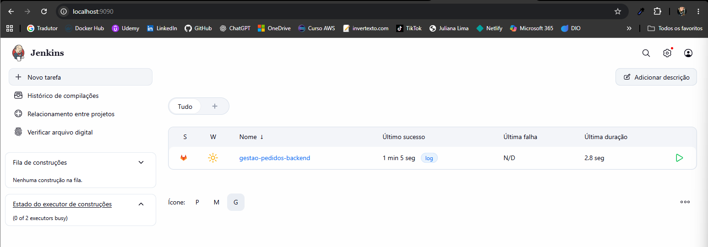
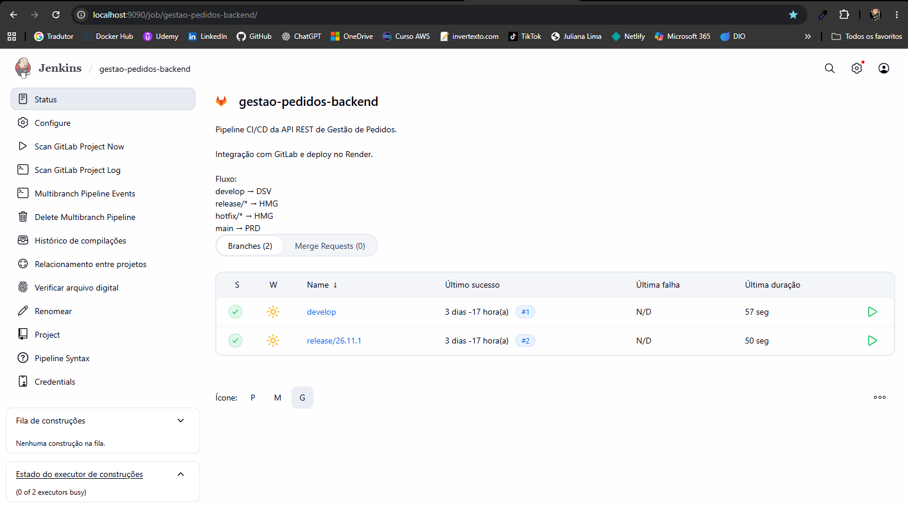
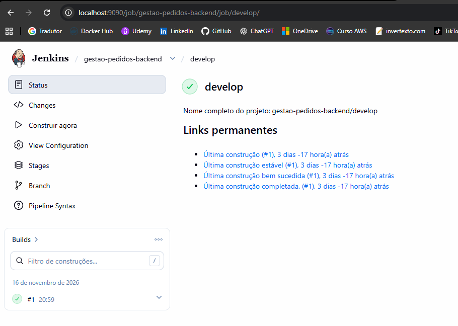
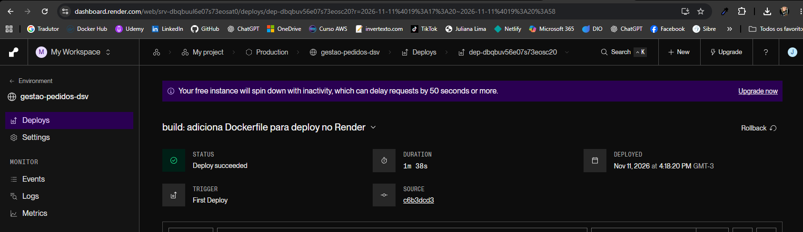
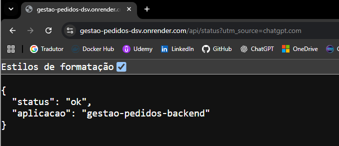

# CI/CD para API Java com Jenkins, Docker, GitLab e Render


> **Laboratório prático de CI/CD:** implementação de pipelines para uma API REST Java/Spring Boot, com build e testes via Maven, Jenkins em Docker e publicação em dois ambientes no Render.

## Objetivo

Documentar a implantação de uma esteira de **integração contínua e entrega contínua (CI/CD)**, desde o commit até a disponibilização de uma aplicação backend em ambientes de desenvolvimento (DSV) e homologação (HMG).

Este repositório é um **estudo de caso de infraestrutura e automação**. Ele não replica o repositório privado da aplicação; apresenta a arquitetura, as evidências de execução, os problemas solucionados e os aprendizados.

## Arquitetura do fluxo



**Nota:** o Jenkins deste laboratório executa localmente em containers. A descoberta de alterações acontece por **varredura periódica**, e não por webhook público do GitLab. O *Deploy Hook* solicita a publicação ao Render; a conclusão efetiva deve ser conferida no Render e no endpoint da aplicação.

### Fluxo de homologação



## Tecnologias utilizadas

| Tecnologia | Papel |
| --- | --- |
| Java 17 / Spring Boot | API REST de exemplo |
| Maven | Build e testes automatizados |
| Git / GitLab | Repositório, branches, Merge Requests e status de build |
| Jenkins | Orquestração da pipeline Multibranch |
| Docker / Docker-in-Docker | Execução do Jenkins e de agentes em containers |
| Render | Hospedagem dos serviços DSV e HMG |

## Branches e ambientes

| Branch | Ambiente | Serviço |
| --- | --- | --- |
| `develop` | Desenvolvimento | `gestao-pedidos-dsv` |
| `release/26.11.1` | Homologação | `gestao-pedidos-hmg` |
| `main` | Produção | Não implementado neste laboratório |

As branches de release recebem mudanças por Merge Request. O uso de `hotfix/*` e a implantação em produção são **evoluções previstas**, não partes concluídas deste laboratório.

## Evidências de execução

### 1. Painel inicial do Jenkins

Jenkins em execução localmente, acessível pela porta `9090`, com o projeto de pipeline cadastrado.



### 2. Descoberta de branches — Multibranch Pipeline

O projeto Jenkins reconhece as branches `develop` e `release/26.11.1`. Na captura, ambas apresentam indicação de sucesso na última execução.



### 3. Execução bem-sucedida da branch develop

A visualização da branch `develop` apresenta uma construção concluída com sucesso. O detalhamento dos estágios pode ser acompanhado em **Stages** ou **Console Output** no Jenkins.



### 4. Publicação inicial no Render — DSV

Registro do **primeiro deploy** da aplicação no serviço `gestao-pedidos-dsv`, com `Deploy succeeded`. **Esta captura é do primeiro deploy, não de um deploy acionado por hook.** As publicações posteriores foram integradas à pipeline por meio de Deploy Hooks.



### 5. Health check da API REST

Consulta ao endpoint de desenvolvimento:

[`GET https://gestao-pedidos-dsv.onrender.com/api/status`](https://gestao-pedidos-dsv.onrender.com/api/status)



Resposta observada:

```json
{
  "status": "ok",
  "aplicacao": "gestao-pedidos-backend"
}
```

Esse teste comprova que o endpoint está acessível e responde corretamente. Não substitui uma bateria completa de testes funcionais.

## Como a pipeline foi configurada

1. **Jenkins Multibranch Pipeline** conectado ao GitLab por credenciais de checkout HTTPS.
2. **`Jenkinsfile` versionado** na raiz do projeto para definir estágios e regras por branch.
3. **Agente Docker** com imagem Maven e JDK para build e execução de testes.
4. **Credenciais Jenkins do tipo `Secret text`** para armazenar URLs dos Deploy Hooks do Render sem expô-las no código.
5. **Estágios condicionais:** `develop` aciona DSV; `release/*` aciona HMG.
6. **Validação após deploy** pelo painel do Render e pelo endpoint `/api/status`.

## Desafios técnicos resolvidos

| Problema observado | Solução aplicada |
| --- | --- |
| Falha de autenticação no checkout do GitLab | Credenciais HTTPS específicas para checkout no Jenkins |
| `Jenkinsfile` não encontrado | Adição do arquivo à raiz das branches monitoradas |
| `Invalid agent type "docker"` | Instalação/configuração do suporte de Pipeline com Docker |
| `docker: not found` dentro do Jenkins | Imagem Jenkins personalizada contendo Docker CLI |
| Execução de containers a partir do Jenkins | Configuração de Docker-in-Docker, rede e certificados TLS |
| Promoção para ambientes diferentes | Estágios condicionados à branch e Deploy Hooks separados |

Para preservar as configurações do Jenkins entre recriações do container, foi utilizado um volume Docker persistente e um backup da configuração local. **Backups, tokens e arquivos de credenciais não devem ser publicados neste repositório.**

## Aprendizados

O laboratório proporcionou experiência prática em **versionamento e estratégia de branches, automação com Jenkins, containerização, troubleshooting de infraestrutura e publicação de aplicações Java**. O principal ganho foi integrar as ferramentas de ponta a ponta e validar seu funcionamento em dois ambientes distintos.

## Melhorias futuras

- Migrar o Jenkins para infraestrutura acessível remotamente com HTTPS e controles de acesso.
- Adotar webhooks para reduzir a dependência da varredura periódica.
- Consultar o status final de implantação no Render antes de considerar o deploy concluído.
- Adicionar análise estática, cobertura e relatórios de testes.
- Implementar aprovação manual para produção.
- Formalizar a estratégia de `feature/*` e `hotfix/*`.

---

**Autoria:** Juliana Lima de Souza  
**Área:** Engenharia de Software · Java Backend / Full Stack · Aprendizado em DevOps e CI/CD

> **Segurança:** todas as imagens deste repositório devem ser revisadas antes da publicação para garantir que não contenham tokens, Deploy Hooks, senhas ou informações internas indevidas.
